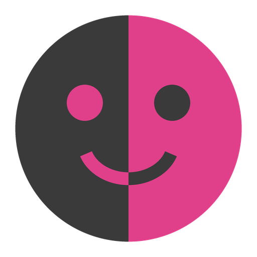
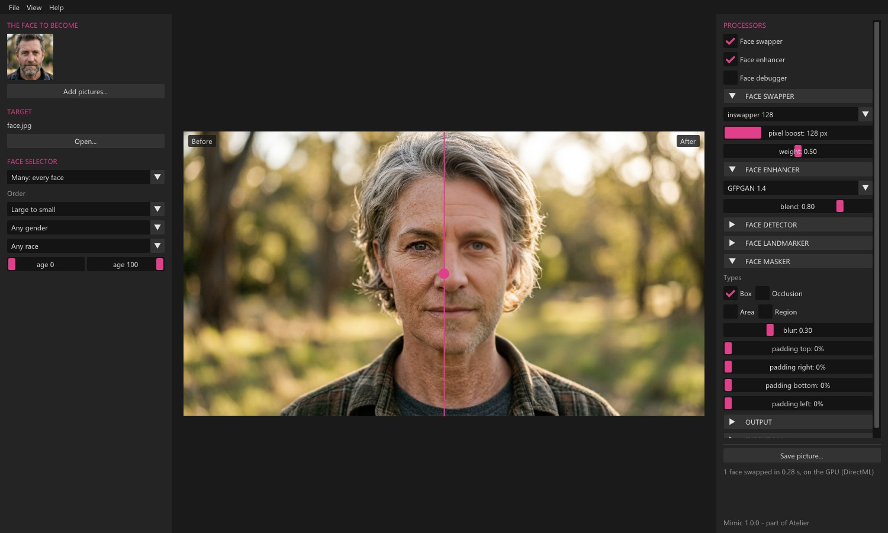
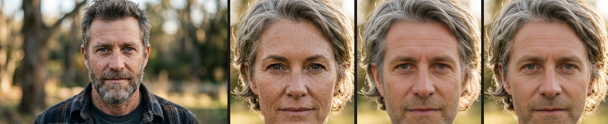
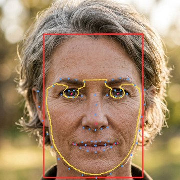

[](https://x.com/NorowaretaGemu)
[](https://opensource.org/licenses/MIT)

<br>
<div align="center">
  <a href="https://ko-fi.com/cursedentertainment">
    
  </a>
</div>
<br>
<div align="center">
  
  
  
  
</div>
<div align="center">
  
  
  
</div>
<br>

<div align="center">
  
</div>

# Mimic

**FaceFusion's face processors, in C++.** Put one person's face onto the faces in a picture or a video,
restore the detail, and see what it did, on your own PC: no Python, a GPU through DirectML (NVIDIA, AMD or Intel),
or the CPU. Part of **[Atelier](https://github.com/CursedPrograms/Atelier)**, Cursed Entertainment's creative suite,
and a plugin for [Chimera](https://github.com/CursedPrograms/Chimera) (Filter > Mimic).
**[Website](https://cursedprograms.github.io/Mimic/)**





> Only use faces you have the right to use. Get consent from the people shown, and say when a picture or video
> has been changed. Don't use Mimic to deceive, harass or impersonate anyone.

## Features

FaceFusion's options, under FaceFusion's names (the command line takes its flags too):

- **Face swapper:** 13 models: inswapper 128 (and fp16), HyperSwap 1a/1b/1c, SimSwap 256 and 512, Ghost 1/2/3,
  HiFiFace, BlendSwap and UniFace. **Pixel boost** (a 2x-4x crop, swapped in several passes) and **weight**
  (more of the source, or more of the target's own look). Several pictures of the same person are averaged.
- **Face enhancer:** 9 models: GFPGAN 1.2/1.3/1.4, CodeFormer (with its fidelity weight), GPEN 256/512/1024/2048
  and RestoreFormer++, with a blend.
- **Face editor (new in 1.1):** change the expression, FaceApp-style, with FaceFusion's 14 dials (LivePortrait): smile,
  eyebrows, eyes open, gaze left/right and up/down, lips open, mouth grim, pout and purse, the mouth's place, and
  the head's pitch, yaw and roll. Or **describe it**: "a big smile, eyes closed", "surprised, looking left",
  "a slight smirk, chin up". The words set the dials, and the dials stay free to fine-tune. No face to become is
  needed: turn the swapper off to change only the expression.
- **Face debugger:** the face box, the 5, 5/68, 68 and 68/5 face points, and the mask's outline.
- **Face detector:** RetinaFace, SCRFD, YOLO-Face, YuNet, or several at once; detector size, turned 0/90/180/270
  degrees for sideways faces, score, margin.
- **Face landmarker:** 2DFAN4 or PeppaWutz (68 points), with a score; FAN 68/5 estimates the 68 from the five.
- **Face selector:** every face, the first face, or the faces like a reference (click a face in the preview);
  8 orders; age span, gender and race filters (FairFace), "like the source" included.
- **Face masker:** box (blur, padding), occlusion (XSeg 1/2/3: hands, hair and glasses in front stay), area (upper
  face, lower face, mouth) and region (BiSeNet face parsing: skin, brows, eyes, glasses, nose, mouth, lips).
- **Video:** frames through ffmpeg with the sound carried over; encoder (x264, x265, VP9, NVENC, AMF, QSV), preset,
  quality, fps, trim; audio encoder, quality and volume. About 6 fps at 720p with GFPGAN on an RTX 2060.
- **The window:** drop pictures of the face to become on the left, a picture or video in the middle; drag the wipe
  between before and after; a video's preview frame on a slider; save the picture or render the video, with Stop.
- **Batch:** many pictures and videos at once with the same face and settings (File > Batch, Ctrl+B, or drop a
  folder): add files or folders (subfolders too), results beside each one or into a folder that keeps the
  subfolders, a name ending, skip the ones already done (a stopped batch carries on), Skip this one, Stop.
- **A Chimera plugin:** Filter > Mimic > Face Swap puts the result in as a new layer, masked to the selection.



## Install

Download **Mimic-win64.zip** from [Releases](https://github.com/CursedPrograms/Mimic/releases), unzip it and run
`install.bat` beside it (Start menu and Desktop shortcuts; Chimera finds it there), or run `Mimic.exe` where it is.
Or install it with the [Atelier launcher](https://github.com/CursedPrograms/Atelier).

The models aren't in the download: each is fetched once, the first time it's used, from
[FaceFusion's model releases](https://github.com/facefusion/facefusion-assets/releases) into
`%APPDATA%\Atelier\models` (or `F:\AIModels` when that folder exists). The window marks the ones still to come.
Videos need [ffmpeg](https://ffmpeg.org/download.html) on the PATH (or `ffmpeg.exe` next to Mimic).

## The command line

```
mimic-cli -s face.jpg [-s more.jpg] -t target.jpg|video.mp4 [-o out] [options]
mimic-cli -s face.jpg -t folder [more files or folders] -o out-folder [--subfolders] [--skip-existing] [--suffix _mimic]

  --processors face_swapper face_editor face_enhancer face_debugger
  --face-editor-prompt "a big smile, eyes closed"   --face-editor-mouth-smile -1..1   (and the other 13 dials)
  --face-swapper-model inswapper_128 | hyperswap_1a_256 | simswap_256 | ghost_1_256 | ...
  --face-swapper-pixel-boost 1..4     --face-swapper-weight 0..1
  --face-enhancer-model gfpgan_1.4 | codeformer | gpen_bfr_512 | restoreformer_plus_plus | ...
  --face-enhancer-blend 0..100        --face-enhancer-weight 0..1
  --face-detector-model retinaface | scrfd | yolo_face | yunet | many
  --face-detector-size 640x640   --face-detector-angles 0 90   --face-detector-score 0.5
  --face-landmarker-model 2dfan4 | peppa_wutz | many   --face-landmarker-score 0.5
  --face-selector-mode many | one | reference   --face-selector-order large-small ...
  --face-selector-gender auto|female|male   --face-selector-race ...   --face-selector-age-start/-end
  --reference-face FILE   --reference-face-distance 0.3
  --face-mask-types box occlusion area region   --face-mask-regions skin nose mouth ...
  --output-video-encoder libx264 ...   --output-video-quality 80   --trim-frame-start/-end
  --execution-providers cpu
```

`mimic-cli --help` lists them all.

## Build

Windows: Visual Studio 2022 (C++) and CMake, then `build.bat` (or `build.ps1`). SDL2 and ONNX Runtime with DirectML
are fetched into `external/` once; the result is `build/Release/` and `dist/Mimic-win64.zip`, and an installed Mimic
is updated. `install.bat` / `install.ps1` install it.

The code, in `src/`:
- `ort.cpp`: ONNX Runtime (loaded at run time; DirectML or the CPU) and the model list
- `faces.cpp`: the detectors, landmarkers, ArcFace and FairFace
- `mimic.cpp`: the face swapper, enhancer, debugger, selector and masker
- `emap.cpp`: reads inswapper's identity matrix straight from its .onnx file
- `video.cpp`: ffmpeg in and out
- `batch.cpp`: batches (the window's and the command line's)
- `gui.cpp`, `splash.cpp`: the window and its splash; `cli.cpp`: `mimic-cli`

## Credits

Mimic's pipeline follows [FaceFusion](https://github.com/facefusion/facefusion) (Henry Ruhs and contributors); Mimic
is its own C++ code. The models are their makers' and keep their own licences, some **non-commercial only**:
InsightFace (SCRFD, ArcFace, inswapper), FaceFusion (HyperSwap), SimSwap, Ghost, HiFiFace, BlendSwap, UniFace,
GFPGAN, CodeFormer, GPEN, RestoreFormer++, XSeg, BiSeNet, FairFace, 2DFAN4, PeppaWutz. See [NOTICE](NOTICE).
Built with [ONNX Runtime](https://github.com/microsoft/onnxruntime), DirectML, [SDL2](https://www.libsdl.org),
[Dear ImGui](https://github.com/ocornut/imgui), [stb](https://github.com/nothings/stb) and [ffmpeg](https://ffmpeg.org).

[Farica☆Kimora](https://github.com/Farica-Kimora) © Cursed Entertainment

<br>
<div align="center">
© Cursed Entertainment 2026
</div>
<br>
<div align="center">
<a href="https://cursed-entertainment.itch.io/" target="_blank">
    
</a>
</div>
